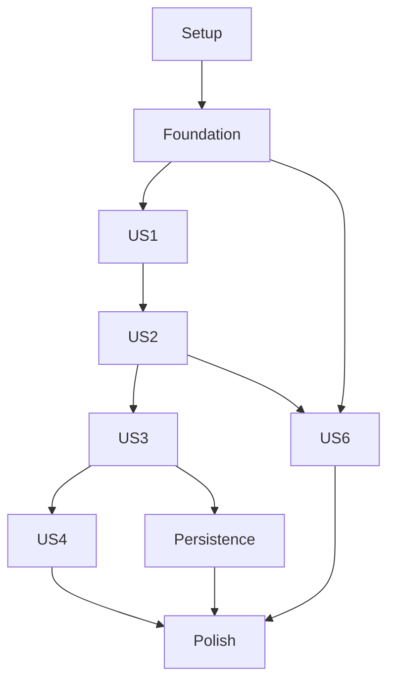

# Tasks: Rikken Scorekeeper Completion and Configurable Scorecard UI

**Input**: Design documents from `specs/002-configurable-scorecard-ui/`

**Prerequisites**: `plan.md`, `spec.md`, `research.md`, `data-model.md`, `quickstart.md`

**Tests**: Automated unit tests are explicitly required by FR-028 and the constitution. Every game-related requirement and edge case is mapped to a story-level test task; browser layout tests supplement domain tests.

**Organization**: Tasks are grouped by user story in priority order (P1 before P2). All paths below are relative to the repository root.

## Phase 1: Setup

**Purpose**: Install the locally bundled UI and browser-test dependencies used by the feature.

- [X] T001 Add Angular Material M3, Materialize CSS, Lucide Angular, and Playwright test dependencies at compatible stable versions in `src/package.json` and `src/package-lock.json`.

## Phase 2: Foundational

**Purpose**: Define the shared domain and persistence contracts required before story implementation.

- [X] T002 Define scoring-system values, verification state, immutable rules snapshots, and discriminated gift inputs in `src/src/app/models/scoring-system.ts` and `src/src/app/models/game.ts`.
- [X] T003 Define the version-2 persisted-state type in `src/src/app/models/persisted-state.ts`.

**Checkpoint**: Shared types are available for all story work; no story should introduce a conflicting game or gift representation.

## Phase 3: User Story 1 - Maintain Scoring Systems (Priority: P1)

**Goal**: Create and maintain named point configurations, with confirmation and snapshot behavior for the cited preset.

**Independent Test**: Create, edit, and remove a scoring system; reject invalid values/names and final-system removal; verify non-retroactive source-preset confirmation and immutable game snapshots.

### Tests for User Story 1

- [X] T009 [P] [US2] Add game-creation tests for four/five-player limits, required distinct names, lineup order, 100 starting points, first dealer, and rules snapshot selection in `src/src/app/services/game.service.spec.ts`.
- [X] T010 [P] [US2] Add remembered-name service tests for saved suggestions, arbitrary new names, and independent lineup order in `src/src/app/services/player-name.service.spec.ts`.
- [X] T011 [US2] Add setup-component tests for required scoring-system selection, blank seats, duplicate names, optional suggestions, and valid four/five-seat creation in `src/src/app/scorecard-setup.component.spec.ts`.

- [X] T004 [US1] Add unit tests for scoring-system creation, editing, case-insensitive names, integer/conservation validation, final-system protection, preset confirmation, and confirmation persistence in `src/src/app/scoring-system.service.spec.ts`.

- [X] T012 [US2] Implement validated game creation with exactly four/five filled seats, generated player/game GUIDs, 100-point starts, and selected rules snapshots in `src/src/app/services/game.service.ts`.
- [X] T013 [US2] Implement local remembered-name suggestions without constraining player choice or order in `src/src/app/services/player-name.service.ts`.
- [X] T014 [US2] Build the new-scorecard form with player count, name suggestions, lineup editing, and required scoring-system selection in `src/src/app/scorecard-setup.component.ts` and `src/src/app/scorecard-setup.component.html`.
- [X] T005 [US1] Add component tests for the scoring-system list/editor, error feedback, delete confirmation, and source-preset confirmation in `src/src/app/scoring-systems.component.spec.ts`.

### Implementation for User Story 1

- [X] T006 [US1] Implement the unverified source preset, numeric-only custom-system validation, and scoring-system CRUD in `src/src/app/services/scoring-system.service.ts`.
- [X] T007 [US1] Add the Dutch scoring-system management view with editable values, confirmation state, and final-system protection in `src/src/app/scoring-systems.component.ts` and `src/src/app/scoring-systems.component.html`.
- [X] T008 [US1] Persist scoring systems and preserve each game's complete rules snapshot through catalog edits/removal in `src/src/app/services/game-repository.service.ts`.

**Checkpoint**: A user can maintain systems and select a confirmed or manual-only preset without changing games already created.

## Phase 4: User Story 2 - Create a Flexible Scorecard (Priority: P1)

**Goal**: Start a four- or five-player game with a selected system, arbitrary lineup/order, and optional remembered-name suggestions.

**Independent Test**: Create both supported player counts with distinct names/order and different selected systems; verify initial totals, limits, and first dealer; reject incomplete or duplicate lineups.

### Tests for User Story 2


### Implementation for User Story 2


**Checkpoint**: Four- and five-player cards start independently with their own selected rules and correct first dealer.

## Phase 5: User Story 3 - Record Gifts with the Chosen Rules (Priority: P1)

**Goal**: Calculate and preview configured contract outcomes using the selected game's immutable snapshot; retain manual entry when automatic scoring is unavailable.

**Independent Test**: Exercise every configured contract/result under two systems; compare preview and saved per-player changes, required conservation, and five-player sit-out behavior.

### Tests for User Story 3

- [X] T015 [US3] Add unit tests for every Rik/Afrik trick count, Troel doubling, solo success/failure, all two-player Miserie combinations, unverified outcomes, integer constraints, and conservation in `src/src/app/services/scoring.service.spec.ts`.
- [X] T016 [US3] Add score-entry component tests for contract participants, preview deltas, manual fallback, imbalance warning, and five-player dealer exclusion in `src/src/app/score-entry.component.spec.ts`.

### Implementation for User Story 3

- [X] T017 [US3] Implement pure contract calculations for configured snapshot values, fixed roles/multipliers, validation, and per-player score changes in `src/src/app/services/scoring.service.ts`.
- [X] T018 [US3] Build the Dutch gift-entry form and per-player preview, including manual score entry for unverified/unconfigured rules, in `src/src/app/score-entry.component.ts` and `src/src/app/score-entry.component.html`.
- [X] T019 [US3] Record gift inputs and applied deltas with stable GUIDs, dealer state, gift-limit enforcement, and snapshot-based scoring in `src/src/app/services/game.service.ts`.

**Checkpoint**: Each supported automatic outcome is previewed before save; manual scoring remains available and no unverified rules are invented.

## Phase 6: User Story 4 - Correct and Review Game History (Priority: P1)

**Goal**: Edit, undo, and delete gifts safely; recalculate totals, progress, dealer order, and final standings without changing surviving IDs.

**Independent Test**: Correct and remove gifts at the beginning, middle, and end of a game; verify totals, dealer progression, completion state, and unchanged remaining GUIDs.

### Tests for User Story 4

- [X] T020 [US4] Add unit tests for gift edit, latest-gift undo, confirmed deletion, middle-history dealer recalculation, stable remaining IDs, limits, and final standings in `src/src/app/services/game.service.spec.ts`.
- [X] T021 [US4] Add component tests for editable saved gifts, destructive-action confirmation, manual correction identification, and completed standings in `src/src/app/score-table.component.spec.ts`.

### Implementation for User Story 4

- [X] T022 [US4] Implement gift update/removal/undo operations that preserve surviving GUIDs and recompute totals, progress, and dealer order in `src/src/app/services/game.service.ts`.
- [X] T023 [US4] Connect table correction controls, delete confirmation, completion/standings state, and manual-correction labels in `src/src/app/score-table.component.ts` and `src/src/app/score-table.component.html`.

**Checkpoint**: Corrections do not duplicate or erase unrelated score changes, and completed cards cannot accept another gift.

## Phase 7: User Story 6 - Navigate a Clear Table-Ready Interface (Priority: P1)

**Goal**: Provide the far-left menu, home/settings side navigation, requested navbar shadow, fixed home plus FAB, Dutch labels, and a five-column mobile layout.

**Independent Test**: Use the menu, home and settings actions, and fixed add button at desktop and Galaxy A54 portrait viewport sizes while scrolling.

### Tests for User Story 6

- [X] T024 [US6] Add component tests for far-left navbar menu, level-5 shadow class, home destination, accessible labels, and fixed home FAB behavior in `src/src/app/app.spec.ts`.
- [X] T025 [US6] Add a Playwright viewport test for five-player table fit, no horizontal overflow, vertical scrolling, and fixed bottom-right FAB at 360x780 CSS pixels in `src/e2e/scorecard-layout.spec.ts` and configure its runner in `src/playwright.config.ts`.

### Implementation for User Story 6

- [X] T026 [US6] Implement the top navbar and side navigation with far-left menu and home destination in `src/src/app/navigation.component.ts` and `src/src/app/navigation.component.html`.
- [X] T027 [US6] Add the accessible round plus FAB fixed to the home viewport bottom-right, including mobile safe-area spacing, in `src/src/app/app.html` and `src/src/app/app.css`.
- [X] T028 [US6] Apply locally bundled Materialize layout patterns, Angular Material M3 interactive components, Lucide action icons, and static M3 baseline roles in `src/src/styles.css` and `src/src/app/app.css`.
- [X] T029 [US6] Adapt the score table to five readable columns at the reference viewport, with dealer/sit-out and accessible Dutch labels, in `src/src/app/app.css` and `src/src/app/score-table.component.html`.

**Checkpoint**: Navigation actions remain discoverable, the home FAB stays fixed while scrolling, and five player columns fit without horizontal scrolling.

## Phase 8: Local Persistence Migration

**Goal**: Migrate old local games and persist new state safely.

**Independent Test**: Migrate seeded v1 data, reload, and verify IDs, score history, and dealer progress.

### Tests for User Story 5

- [X] T030 [P] [US5] Add repository tests for v1 active/archive migration, seven-player display-only legacy history, ID merge precedence, source-key retention on failed migration, localStorage denial/quota errors, and save failure reporting in `src/src/app/services/game-repository.service.spec.ts`.

### Implementation for User Story 5

- [X] T033 Implement version-2 local-state persistence, validated v1 migration, archive merge, and visible storage failure results in `src/src/app/services/game-repository.service.ts`.

**Checkpoint**: Migrated records resume exactly once and failed storage operations are visible.

## Phase 9: Polish and Cross-Cutting Concerns

**Purpose**: Complete user documentation and run the feature's required quality gates.

- [X] T036 Update `src/README.md` with supported Node/npm versions, `npm ci`, development/tests/build, static deployment and SPA fallback, local-data limitations, and Dutch workflows for setup/scoring/corrections/history.
- [X] T037 Run `npm ci`, `npm test -- --watch=false`, `npm run build`, and the viewport test from `src/package.json`; fix failures and verify documented commands and bundled assets.
- [X] T038 Review every in-scope functional requirement and edge case against the unit-test files listed in `specs/002-configurable-scorecard-ui/plan.md`; close any untested game rule or state transition before release.

## Dependencies and Execution Order

### Phase Dependencies

- **Setup**: No dependencies.
- **Foundational**: Depends on Setup; shared domain types block story implementation.
- **US1**: Depends on Foundational; establishes the selectable scoring systems used by new games.
- **US2**: Depends on US1 for system selection and on Foundational for the game model.
- **US3**: Depends on US1 and US2 for rules snapshots, player roles, and gift state.
- **US4**: Depends on US3 for recorded gift inputs and changes.
- **US6**: Depends on Foundational; can be developed in parallel with US3/US4 once the shell and models are stable.
- **Persistence migration**: Depends on US3's game/gift shape and runs after the P1 stories.
- **Polish**: Depends on all desired stories being implemented.

### Dependency Graph



### Parallel Opportunities

- After Foundational, T009 and T010 can be written in parallel because they cover game creation and remembered-name services in separate test files.
- After US3's model is stable, persistence migration tests can be written against the repository boundary.
- US6 navigation/layout work can proceed independently of the scoring/correction implementation after foundational types.

## Implementation Strategy

### MVP First

Deliver US1 plus the minimum US2 system-selection path: users can maintain a named scoring system, choose it when creating a four/five-player scorecard, and the game retains its rules snapshot. This small setup slice is required to independently prove US1's selection scenario. Then add contract scoring (US3), corrections/history (US4), navigation/table usability (US6), and local migration.

### Incremental Delivery

1. Setup and foundational model contracts.
2. US1 scoring-system maintenance, including required domain tests.
3. US2 validated lineup and rules selection.
4. US3 automatic/manual gift scoring and preview.
5. US4 corrections, undo, archive, and final standings.
6. US6 navigation and responsive table interface.
7. Local persistence migration.
8. Documentation, full test suite, production build, and viewport acceptance.

### Parallel Execution Examples

```text
After foundation:
- T009 game creation unit tests in src/src/app/services/game.service.spec.ts
- T010 remembered-name unit tests in src/src/app/services/player-name.service.spec.ts

After the game/gift model is stable:
- T030 migration/persistence unit tests in src/src/app/services/game-repository.service.spec.ts
```

## Notes

- Every task has a unique sequential ID and repository-relative file path.
- `[P]` marks only tasks that can use separate files without waiting on one another.
- Tests are required here by FR-028 and the constitution; implement the specific tests in their user-story phase.
- Story phases are independently testable at their stated checkpoints; listed dependencies identify where stories consume shared behavior.
